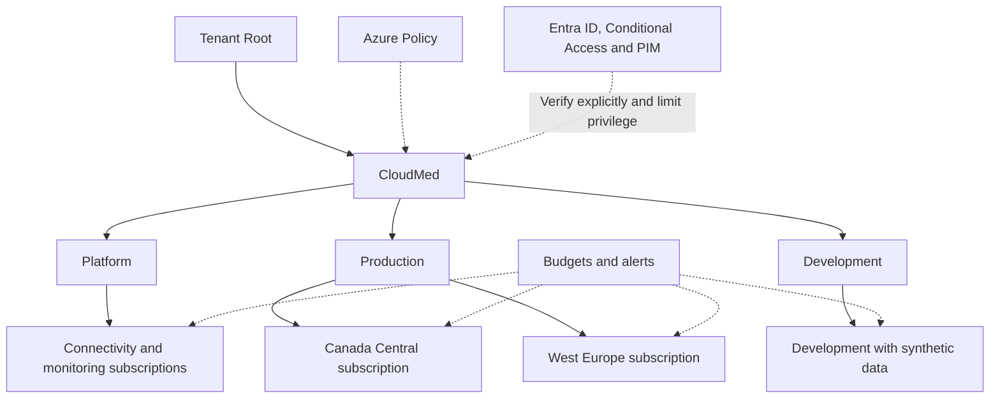
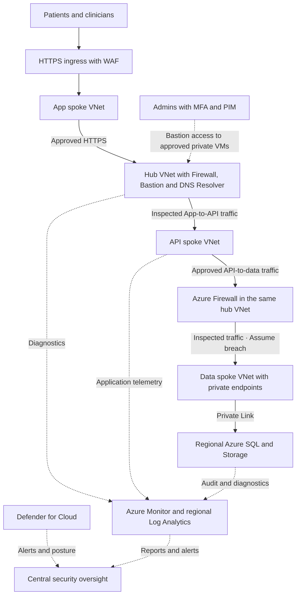

# CloudMed Solutions Inc. | Zero Trust Azure Landing Zone

## 1. Company Overview

CloudMed Solutions Inc. provides telemedicine and patient management services to hospitals and clinics in Canada, the United States, and Europe. Its MedConnect platform supports video consultations, electronic medical records (EMRs), and AI-based health analytics. The proposed Azure footprint uses Canada Central and West Europe.

Clinicians, patients, administrators, and service identities access MedConnect from different locations and devices. Zero Trust reduces the risk that a stolen credential or compromised application can expose patient records across hospitals, tiers, or regions. HIPAA, GDPR, and PIPEDA drive requirements for access controls, auditability, and protection of health information. Before production, CloudMed's privacy team should validate applicable agreements, retention rules, and cross-border processing arrangements, including where US patient data can be hosted within the two-region footprint.

## 2. Governance and Identity

| Management group | Subscription structure and purpose |
|---|---|
| Tenant Root → CloudMed | Common policy baseline for CloudMed subscriptions |
| CloudMed → Platform | Connectivity subscription for regional hubs and Management subscription for monitoring |
| CloudMed → Production | Separate MedConnect subscriptions for Canada Central and West Europe |
| CloudMed → Development | Separate nonproduction subscription using synthetic patient data |

Microsoft Entra ID provides workforce identity. Conditional Access evaluates sign-in risk, location, and device compliance for staff, with MFA and compliant devices required for privileged access. Patient sign-in uses a separate customer identity configuration and application-level authorization. MedConnect checks each patient's or clinician's access to the requested record. Workloads use managed identities for supported Azure services.

| Group | Azure RBAC scope and access |
|---|---|
| Platform admins | Scoped management permissions for platform resources through Entra Privileged Identity Management (PIM), with approval and time-limited activation |
| DevOps | Deployment permissions scoped to application resource groups. Production releases use a dedicated pipeline identity and approvals |
| Finance | Cost Management Reader at the required subscription scope and scoped budget management permissions for designated staff |

Assign Azure Policy initiatives at the CloudMed management group and refine them by environment. Allow regional workloads only in Canada Central and West Europe. Document exceptions for approved global services. Require ownership, environment, and cost-center tags where supported. Enforce approved resource types and diagnostics, deny public access on SQL and storage, and restrict public IP creation to approved platform or ingress resources.

## 3. Network Architecture

Each region has a hub VNet and separate production spokes for the App, API, and Data tiers. The hub contains Azure Firewall, Azure Bastion in its dedicated subnet, and Azure DNS Private Resolver. Log Analytics is a shared management service rather than a component hosted inside a VNet. Regional workspaces support regional log handling with central oversight.

The App spoke hosts the web tier behind a WAF-enabled HTTPS entry point. The API spoke hosts internal backend services. The Data spoke hosts private endpoints for regional Azure SQL Database and Azure Storage. Each spoke has dedicated subnets for its workloads or private endpoints. Development uses a separate VNet with no route to production.

Peer each spoke with its regional hub and use route tables and network security groups to control east–west traffic. Route approved inter-spoke flows through Azure Firewall and scope private-endpoint subnet policies and routes to the inspected paths. Allow App-to-API HTTPS and authorized API-to-data connections only. Deny direct App-to-Data and cross-region workload traffic by default. Link private DNS zones to the required networks so SQL and Storage names resolve to private IPs. Keep public network access disabled on both services.

## 4. Zero Trust Controls

| Principle | Design example |
|---|---|
| Verify explicitly | Require MFA and risk-based Conditional Access for clinicians and staff. The API validates tokens and checks record-level authorization on each request. |
| Use least privilege | Require PIM activation for administrators. Use Bastion for approved administration of private VMs and avoid exposing SSH or RDP ports. |
| Use least privilege | Give the API's managed identity only the SQL and Storage data permissions it needs. Scope access by region and workload. |
| Assume breach | Inspect approved traffic between spokes and use Private Link for SQL and Storage. Restrict public IPs through Azure Policy. |
| Assume breach | Encrypt data in transit and at rest. Alert on suspicious activity and use an incident playbook to revoke sessions, isolate the affected workload, and preserve audit logs. |

## 5. Monitoring, Compliance, and Cost

Send Azure Activity Logs, firewall diagnostics, SQL audit events, and application telemetry to Azure Monitor and regional Log Analytics workspaces. Display security alerts and posture findings centrally with Microsoft Defender for Cloud. Limit access to detailed logs and exclude patient records and credentials from telemetry.

Use Azure Policy compliance reports to track allowed regions, public exposure, tagging, and diagnostic settings. Assign remediation owners, record approved exceptions with expiry dates, and retain audit evidence according to the applicable policy. Review HIPAA, GDPR, and PIPEDA obligations with the privacy team and map them to technical controls and operational procedures. Use the reports as audit evidence alongside these reviews.

Use subscription budgets with alerts at 50%, 80%, and 100% of the planned amount. Notify Finance and the workload owner when thresholds are reached. Use cost-center and environment tags to allocate costs and investigate spikes. Budget alerts prompt review and action. They do not automatically stop spending.

## 6. Conceptual Diagram

### Management groups and shared controls

### Hub and spoke pattern in each production region

The diagram represents one region. CloudMed uses the same pattern in Canada Central and West Europe, with separate networks and data endpoints.

Identity checks verify access explicitly. PIM and scoped workload identities enforce least privilege. The WAF, segmented spokes, firewall, private endpoints, and audit logging support the assume-breach principle.

## 7. Summary and Recommendations

CloudMed can add regional workloads through dedicated subscriptions and spokes while applying common identity, governance, and monitoring controls. Regional data services, approved traffic paths, and centralized oversight help limit the impact of a breach and support compliance reviews.

1. Automate management groups, policies, and regional network configuration with Bicep and a reviewed deployment pipeline so future environments follow the same baseline.
2. Run recurring incident-response and backup-restore exercises in each region. Track recovery times and confirm that restoration respects approved data locations.

## References

- [Azure landing zones](https://learn.microsoft.com/en-us/azure/cloud-adoption-framework/ready/landing-zone/)
- [Microsoft Zero Trust overview](https://learn.microsoft.com/en-us/security/zero-trust/zero-trust-overview)
- [Azure hub-and-spoke architecture](https://learn.microsoft.com/en-us/azure/architecture/networking/architecture/hub-spoke)
- [Azure governance](https://learn.microsoft.com/en-us/azure/governance/)
- [Azure Monitor](https://learn.microsoft.com/en-us/azure/azure-monitor/overview)
- [Microsoft Defender for Cloud](https://learn.microsoft.com/en-us/azure/defender-for-cloud/defender-for-cloud-introduction)
- [Azure cost management best practices](https://learn.microsoft.com/en-us/azure/cost-management-billing/costs/cost-mgt-best-practices)
